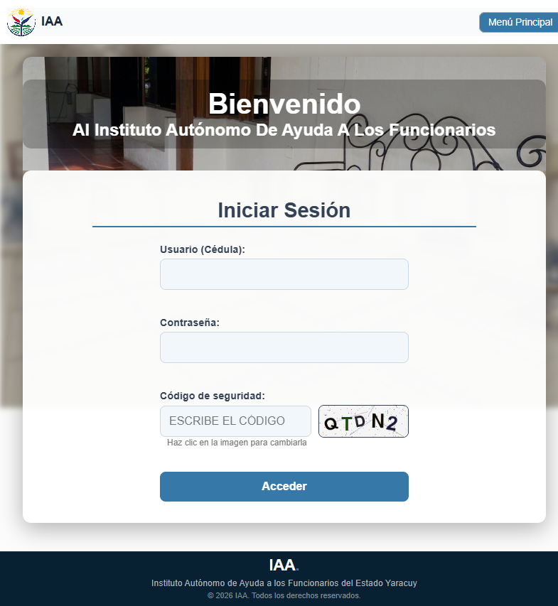

# Login IAA · PHP + PostgreSQL

Aplicación de **inicio de sesión y registro** en **PHP 8.2+ + PostgreSQL** adaptada del sistema del **IAA (Instituto Autónomo de Ayuda a los Funcionarios, Yaracuy, Venezuela)**. La foto de cédula es opcional: la verificación automática de identidad está desactivada y el archivo no se usa ni se conserva.

> Autentica contra PostgreSQL, aplica controles de fuerza bruta/CSRF/captcha y registra sesiones en bitácora. El registro valida el formato de la cédula y evita cuentas duplicadas, pero **no comprueba que la persona sea titular de esa cédula**.

---

## Características

- **Login y registro directo**: acceso (cédula + contraseña + captcha) y alta de cuenta particular **activa** (sin verificación por correo/aprobación en este demo), manteniendo validaciones y controles de seguridad del sistema original.
- **Registro sin verificación documental**: la cédula se valida por formato y se comprueba que no exista ya una cuenta. La foto es opcional; si se adjunta, no se envía en el flujo AJAX, no se analiza ni se guarda. Los datos se completan manualmente.
- **Cédula venezolana**: validación por formato (7 u 8 dígitos), sin dígito verificador.
- **Mensajes genéricos**: nunca se revela si la cédula existe (`El usuario o la clave son incorrectas`).
- **Hash ficticio anti-enumeración**: si la cédula no existe se compara contra un hash bcrypt real para igualar tiempos de respuesta.
- **Bloqueo progresivo**: 5 intentos fallidos → 10 min; 2.º bloqueo consecutivo → 30 min; 3.º → 120 min (tabla `intentos_login`).
- **Rate limit** por IP (20/min) y por IP + cédula (30/5 min) → HTTP 429.
- **CSRF firmado**: token HMAC-SHA256 con secreto y nonce (TTL 12 h, un uso).
- **Captcha GD** propio (imagen PNG, sin servicios externos).
- **Sesión endurecida**: cookies `HttpOnly` + `SameSite=Lax` (+ `Secure` bajo HTTPS), modo estricto, regeneración de ID al autenticar, rotación periódica y **cierre por inactividad** (keep-alive / beacon al cerrar pestaña).
- **Contraseñas**: `bcrypt` (`password_hash`/`password_verify`), complejidad mínima y rehash automático si cambian los parámetros.
- **PostgreSQL + PDO** con *prepared statements*. En producción se debe configurar un usuario de aplicación con privilegios mínimos. Incluye una envoltura de compatibilidad (`Conexion`) para conservar la API `mysqli` del sistema original.
- **Cabeceras de seguridad**: CSP estricta con nonce, `X-Frame-Options: DENY`, `nosniff`, `Referrer-Policy`, `Permissions-Policy` y HSTS cuando hay HTTPS.
- **Auditoría**: tabla `logeo` (ingreso/salida, IP, agente, token de sesión) y `bitacora` **inmutable** (trigger que impide `UPDATE`/`DELETE`).
- **Sin dependencias externas**: `composer.json` solo define scripts auxiliares.

---

## Stack y requisitos

| Componente | Versión / detalle |
| --- | --- |
| PHP | 8.2+ (probado con 8.3). Extensiones: `pdo_pgsql`, `pgsql`, `mbstring`, `gd`, `fileinfo`, `openssl`. |
| PostgreSQL | 14+ (probado con 18). |
| Servidor | Apache con `mod_rewrite`/`.htaccess` o el servidor embebido de PHP (`php -S`) con `router.php`. |
| SO | Portable (Windows / Linux). En Windows se probó con XAMPP. |

---

## Estructura

```text
php-login-seguro/ (repo: login_iaa)
├─ .env.example          Plantilla de variables (copiar a .env)
├─ .htaccess             Redirección a public/ y bloqueo de rutas sensibles
├─ router.php            Barreras equivalentes para `php -S`
├─ Dockerfile            Imagen PHP+Apache con extensiones necesarias
├─ docker-compose.yml    App + PostgreSQL (dev)
├─ config/
│  ├─ env.php                 Carga de .env
│  ├─ rutas.php               BASE_URL dinámico y helpers de URL
│  ├─ Conexion.php            Punto de conexión (PDO, API compatible mysqli)
│  ├─ Database.php            Singleton PDO
│  ├─ seguridad.php           Sesión, CSRF, captcha, rate limit, cabeceras
│  ├─ ocr_helper.php / evidencia_helper.php  Módulos heredados, no conectados al registro
│  ├─ directorios.php         Rutas de evidencias/logs/backups
│  └─ ...
├─ controllers/
│  ├─ validacionController.php    Paso 1 de registro: formato de cédula y cuenta duplicada
│  ├─ registroController.php      Paso 2 registro: crea cuenta activa
│  ├─ funcionarioLoginController.php  Autenticación y bloqueo
│  ├─ logoutController.php
│  ├─ keep_alive.php / cerrar_sesion_navegador.php
├─ models/
│  ├─ ValidacionModel.php / RegistroModel.php / LoginModel.php
│  ├─ CedulaOcr.php            Parser heredado, no conectado al registro
│  └─ ...
├─ public/
│  ├─ css/  js/  logeo/
│  │  ├─ login.php           Formulario de acceso
│  │  ├─ validacion.php      Paso 1: cédula + captcha; foto opcional y no utilizada
│  │  ├─ registrar.php       Paso 2: datos y creación de cuenta
│  │  └─ captcha.php         Imagen del captcha
├─ views/                    Menú post-login y parciales
├─ database/
│  ├─ schema.sql             Esquema PostgreSQL + semillas + bitácora inmutable
│  └─ instalar.php           Instalador CLI (idempotente)
├─ scripts/
│  ├─ crear_usuario.php      Alta de cuentas extra
│  └─ lint.php               Lint PHP de todo el proyecto
└─ docs/login.png            Captura de referencia
```

---

## Puesta en marcha

### Opción A — Docker (recomendado)

Requisitos: Docker y Docker Compose.

1. **Configurar entorno (opcional)**: `docker-compose.yml` define valores de desarrollo. Para personalizar, crea `.env` o ajusta las variables de base de datos del servicio `app`.
2. **Levantar servicios**:
   ```bash
   docker compose up --build
   ```
   - App: <http://localhost:8080/public/logeo/login.php>
   - PostgreSQL expuesto en el host en `5433` (el contenedor `app` usa `db:5432`).
3. **Instalar esquema y usuario demo** (en otra terminal, con los contenedores arriba):
   ```bash
   docker compose exec app php database/instalar.php --admin-user=login_demo --admin-pass=cambia_esta_clave
   ```
   Ajusta credenciales si cambiaste las del servicio `db`. El instalador es idempotente.
4. **Listo**. El instalador muestra la contraseña generada para la cuenta demo; guárdala, porque no se vuelve a mostrar.

> Nota: Docker Compose es solo para desarrollo. El usuario inicial de PostgreSQL también se usa por la app y tiene privilegios elevados. Para producción, configura un usuario de aplicación con privilegios mínimos, secretos seguros, HTTPS y una imagen que copie el código en lugar de montar el volumen.

### Opción B — Manual (XAMPP / PHP embebido)

#### 1. Clonar/copiar el proyecto

Coloca la carpeta dentro de `htdocs` (o en cualquier ruta servida por PHP):

```text
C:\xampp\htdocs\para github\login_iaa
```

#### 2. Crear la base de datos

Con `psql` disponible (ajusta la ruta a tu instalación de PostgreSQL):

```powershell
psql -U postgres -h 127.0.0.1 -c "CREATE ROLE login_demo WITH LOGIN PASSWORD 'cambia_esta_clave';"
psql -U postgres -h 127.0.0.1 -c "CREATE DATABASE login_demo OWNER login_demo;"
```

#### 3. Configurar el entorno

```powershell
copy .env.example .env
```

Edita `.env` con tus credenciales de PostgreSQL:

```ini
IAA_DB_HOST=127.0.0.1
IAA_DB_PORT=5432
IAA_DB_USER=login_demo
IAA_DB_PASS=cambia_esta_clave
IAA_DB_NAME=login_demo
IAA_DB_SSLMODE=prefer

```

> `.env` está bloqueado por `.htaccess`/`router.php` y **nunca debe subirse** al repositorio.

#### 4. Instalar esquema y usuario demo

```powershell
php database/instalar.php --admin-user=postgres --admin-pass=TU_CLAVE_POSTGRES
```

El instalador aplica `database/schema.sql`, crea el rol/BD si faltan (cuando se le dan credenciales de administrador), inserta las semillas y crea/actualiza el **usuario demo**. Es idempotente.

#### 5. Levantar el servidor

**Opción rápida (PHP embebido, recomendada para probar):**

```powershell
php -S localhost:8000 router.php
# o: composer serve
```

Abre <http://localhost:8000/public/logeo/login.php>.

**Opción Apache (XAMPP):**

Asegúrate de tener `mod_rewrite` activo y `AllowOverride All`. Abre  
<http://localhost/para%20github/login_iaa/public/logeo/login.php>.

---

## Flujo de registro

1. En [`public/logeo/validacion.php`](public/logeo/validacion.php), el usuario ingresa una cédula de 7 u 8 dígitos y resuelve el captcha. Adjuntar una foto es opcional.
2. El servidor comprueba el formato y que la cédula no tenga ya una cuenta. No analiza ni conserva la foto; los datos personales se completan manualmente.
3. En [`public/logeo/registrar.php`](public/logeo/registrar.php), completa los datos, la contraseña y acepta la política de privacidad. La cuenta se crea activa con rol particular.

> Esta versión no verifica la titularidad de la cédula. La foto adjunta no se procesa ni se guarda por la aplicación.

---

## Credenciales demo

| Campo | Valor |
| --- | --- |
| Cédula (usuario) | `12345678` |
| Contraseña | Generada al instalar; se muestra una sola vez en la consola |
| Rol | `administrador` |

> La contraseña aleatoria debe guardarse durante la instalación. No reutilices las credenciales de desarrollo en producción.

---

## Scripts útiles

```bash
composer serve          # php -S localhost:8000 router.php
composer db:install     # instala esquema + demo (requiere .env con credenciales admin o flags)
composer user:create    # crea otra cuenta (ver --help)
composer lint           # lint PHP de todo el proyecto
composer check          # alias de composer lint

php scripts/crear_usuario.php --cedula=19876543 --nombre="Ana Pérez" \
  --correo=ana@example.com --rol=particular --password="Clave#2026"
```

---

## Detalles de seguridad (resumen)

| Amenaza | Mitigación |
| --- | --- |
| Fuerza bruta / credential stuffing | Bloqueo progresivo (10/30/120 min) + rate limit por IP y por IP+cédula (429). |
| Enumeración de usuarios | Respuesta genérica + hash ficticio para igualar tiempos. |
| CSRF | Token HMAC firmado, ligado a sesión, con TTL y un solo uso. |
| Bots básicos | Captcha GD propio. |
| Fijación/robo de sesión | Regeneración de ID, cookies HttpOnly/SameSite, strict mode, rotación e inactividad. |
| XSS / clickjacking / MIME sniffing | CSP con nonce, `X-Frame-Options: DENY`, `nosniff`, `Referrer-Policy`. |
| SQL injection | Consultas preparadas (PDO) y validación de formato de cédula. |
| Registro de cédula | Validación de formato y duplicados. No verifica identidad ni titularidad documental. |
| Contraseñas débiles/obsoletas | Complejidad mínima, bcrypt y rehash automático. |
| Integridad de auditoría | `bitacora` inmutable por trigger (solo inserción). |

---

## Al subir a GitHub (buenas prácticas)

- **No subir secretos ni datos reales**: `.env`, credenciales, fotos de identidad y logs personales no deben entrar al repositorio.
- **Revisar permisos de publicación** del código institucional, logos y fotografías antes de hacer público el repositorio.
- **Incluir `Dockerfile` y `docker-compose.yml`** para que el entorno de desarrollo PHP + PostgreSQL sea reproducible.
- **`.env.example` sí, `.env` no**. Mantén valores de ejemplo, nunca reales.
- **Datos personales**: no agregues imágenes de cédula ni otros datos personales al repositorio, issues ni PRs.
- **Licencias**: el código proviene de un sistema institucional; revisa la licencia/permiso antes de hacerlo público si aplica.

---

## Captura



---

## Contexto

Adaptación a partir de módulos del sistema **`iaa_iuty`**, reducida a lo esencial para demostrar login y registro en PHP con PostgreSQL. La verificación documental por foto/OCR está desactivada; cualquier futura implementación debe informar al usuario y definir el tratamiento de esos datos personales.
